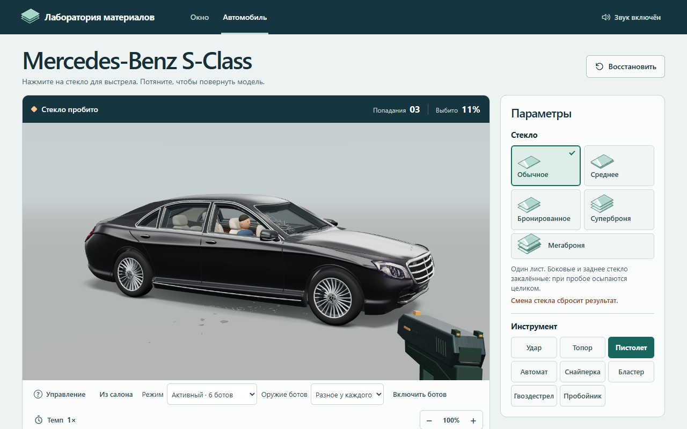

# Window Glass Lab (Bronestekla)

An interactive 3D lab for comparing window glass: from ordinary to "mega armor". Pick a glass type and a tool, click the glass to hit it, and watch the shards. A second tab puts the glass in a Mercedes-Benz S-Class with scripted bots around it. The interface is in Russian.



**[Open the lab](https://antropos17.github.io/bronestekla/)**

## Use

It is a single self-contained `index.html` (about 5 MB, model and physics engine embedded). Open it in a browser or serve the folder:

```bash
python -m http.server 8000
```

Controls: click the glass to hit it, drag to rotate the model, scroll or pinch to zoom, `Tab` and arrow keys for the controls.

## Stack

three.js and the Rapier 3D physics engine, embedded in the page.

## Credits

Character models by Quaternius (CC0), three.js (MIT), Rapier 3D (Apache 2.0). Details in [CREDITS.md](CREDITS.md).
